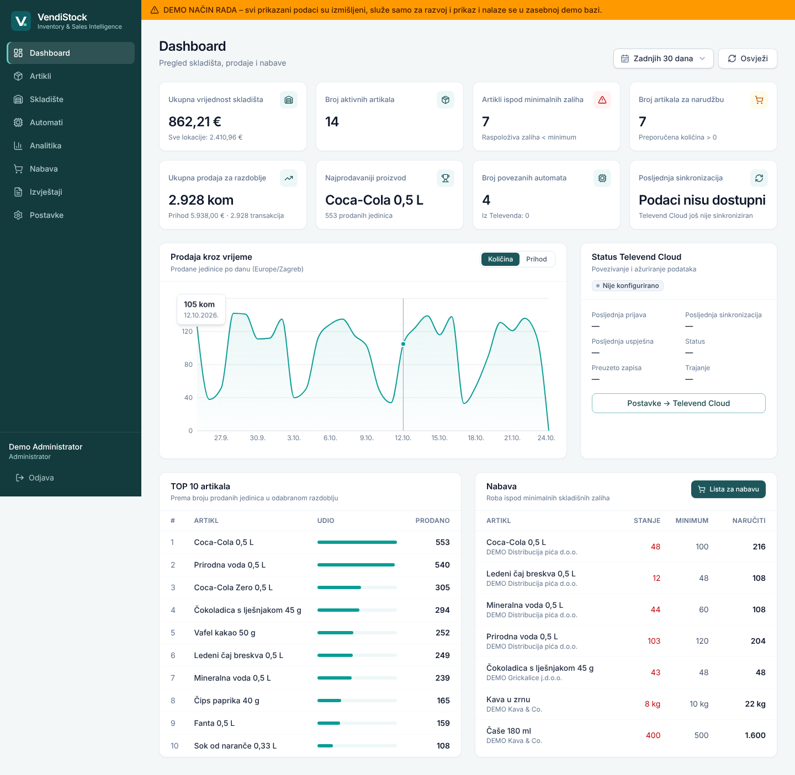

# VendiStock 1.1.0-test.1 – Inventory & Sales Intelligence

Interna lokalna web aplikacija **Vending Expressa** za upravljanje zalihama, skladištem, prodajom i nabavom robe
samoposlužnih automata, s automatiziranim preuzimanjem podataka iz korisničkog web portala **Televend Cloud**.

- Radi lokalno na Windows 10/11 računalu (server) i dostupna je iz uredske lokalne mreže (LAN).
- Sva poslovna evidencija je u lokalnoj SQLite bazi – bez vanjskog hostinga i cloud baza.
- Nije javno dostupna s interneta (ograničenje na privatne mreže u aplikaciji + pravilo vatrozida).

> **Važno – Televend Cloud:** konektor (prijava kroz web portal, istraživanje portala, izvoz/čitanje izvještaja,
> uvoz, sinkronizacija) je izrađen i automatski testiran na **lokalnom testnom portalu**. Povezivanje sa
> **stvarnim** Televend Cloudom **nije testirano** jer razvojno okruženje nije imalo pristup domeni Televenda,
> a stvarna adresa portala, struktura stranica i format izvoza nisu poznati. VendiStock zato **ne pretpostavlja**
> URL-ove, selektore ni nazive stupaca: nakon prve prijave potrebno je pokrenuti „Istraži portal” i konfigurirati
> izvore podataka prema stvarnim stranicama (ili poslati primjer izvještaja). Vidi [docs/TELEVEND-CONNECTOR.md](docs/TELEVEND-CONNECTOR.md).



*Snimke zaslona prikazuju zasebnu **demo bazu s izmišljenim podacima** (označeno narančastom trakom).*

---

## Sadržaj

1. [Struktura projekta](#struktura-projekta)
2. [Tehnologije](#tehnologije)
3. [Moduli i funkcionalnosti](#moduli-i-funkcionalnosti)
4. [Instalacija na Windows](#instalacija-na-windows)
5. [Prvo povezivanje s Televend Cloudom](#prvo-povezivanje-s-televend-cloudom)
6. [Konfiguracija (.env)](#konfiguracija-env)
7. [Backup i oporavak](#backup-i-oporavak)
8. [Sigurnost](#sigurnost)
9. [Razvoj, testovi i demo način](#razvoj-testovi-i-demo-način)
10. [Rezultati testova](#rezultati-testova)
11. [Ograničenja i preostali posao](#ograničenja-i-preostali-posao)

---

## Struktura projekta

```
VendiStock/
├── package.json                 # npm workspaces (server, client) i zajedničke naredbe
├── .env.example                 # predložak konfiguracije servera
├── README.md
├── CHANGELOG.md                 # popis promjena po verzijama
├── docs/
│   ├── ARHITEKTURA.md           # arhitektura, model podataka, skladišna knjiga, deduplikacija
│   ├── TELEVEND-CONNECTOR.md    # Televend konektor: tijek, sigurnost, konfiguracija, ograničenja
│   ├── TESTIRANJE.md            # popis i rezultati izvršenih testova
│   └── screenshots/
├── scripts/windows/
│   ├── install.ps1              # instalacija (ovisnosti, izgradnja, Chromium, .env, prava, admin)
│   ├── New-VendiStockCertificate.ps1  # lokalni CA + HTTPS certifikat servera
│   ├── Set-VendiStockFirewall.ps1     # pravilo vatrozida (samo LocalSubnet, Private profil)
│   ├── service-install.cjs / service-uninstall.cjs  # Windows servis (node-windows/WinSW)
│   └── start-vendistock.cmd     # ručno pokretanje (testiranje)
├── server/                      # Node.js + TypeScript backend (Fastify, SQLite, Playwright)
│   ├── src/
│   │   ├── index.ts / main.ts   # ulazna točka
│   │   ├── app.ts               # HTTP server, sigurnosni slojevi, rute
│   │   ├── config.ts            # konfiguracija iz .env
│   │   ├── db/                  # SQLite, migracije (schema.ts)
│   │   ├── auth/                # lozinke (scrypt), sesije, CSRF
│   │   ├── lib/                 # DPAPI + šifriranje tajni, vrijeme (Europe/Zagreb), izvoz XLSX/PDF
│   │   ├── modules/             # artikli, skladište, nabava, upozorenja, e-mail, analitika, backup, normativi…
│   │   ├── televend/            # konektor: preglednik, prijava, istraživanje, izvoz, parser, uvoz, sinkronizacija
│   │   ├── scheduler/           # pozadinski planer (sinkronizacija, backup, upozorenja, e-mail)
│   │   ├── routes/              # REST API
│   │   └── cli/                 # createUser, seedDemo
│   └── test/                    # Vitest testovi + testni portal + E2E test sučelja
└── client/                      # React + TypeScript + Tailwind + Recharts (Vite)
    └── src/
        ├── pages/               # Dashboard, Artikli, Skladište, Automati, Analitika, Nabava, Izvještaji, Postavke
        ├── components/          # tablica, grafikoni, obrasci, izgled
        └── lib/                 # API klijent, autentifikacija, formatiranje (hr-HR)
```

## Tehnologije

| Komponenta | Tehnologija (verzija) |
|---|---|
| Frontend | React 19, TypeScript 5.9, Vite 8, React Router 7, TanStack Query 5 |
| Dizajn | Tailwind CSS 4, Inter (lokalno), lucide ikone |
| Grafovi | Recharts 3 |
| Backend | Node.js 22/24 LTS, TypeScript 5.9, Fastify 5 |
| Baza | SQLite (better-sqlite3 12, WAL način) |
| Automatizacija portala | Playwright 1.63 (Chromium) |
| E-mail | Nodemailer (SMTP, lozinka ili OAuth2) |
| Validacija | Zod 4 |
| Izvoz | ExcelJS (XLSX), PDFKit + DejaVu Sans (PDF s hrvatskim znakovima) |
| Testovi | Vitest 5, Playwright |

Nisu korišteni Supabase, Firebase ni bilo kakav vanjski hosting ili vanjska baza.

## Moduli i funkcionalnosti

**Dashboard** – 8 KPI kartica (vrijednost skladišta, aktivni artikli, artikli ispod minimuma, artikli za narudžbu,
prodaja razdoblja, najprodavaniji proizvod, povezani automati, posljednja sinkronizacija), graf prodaje kroz vrijeme
(odabir razdoblja), TOP 10 artikala, nabava, status Televend Clouda. Bez podataka prikazuje „Podaci nisu dostupni”.

> **Načelo rada (od 1.1.0):** ručno se unosi samo **nabavna (ulazna) cijena** (i po želji ulaz robe s cijenom).
> Artikle, automate i kretanja zaliha VendiStock generira sam iz Televend podataka – vidi [CHANGELOG.md](CHANGELOG.md).

**Artikli** – interna šifra (jedinstvena), naziv, kategorija, dobavljač, nabavna cijena, JM, pakiranje, minimalna i
ciljana zaliha, trenutno stanje (iz skladišne knjige), status; kategorije, dobavljači. Novi Televend artikli
**automatski postaju lokalni artikli** (šifra `TV-<ID>`, oznaka „iz Televenda”, cijena „nije unesena”); postojeći
artikl istog naziva se povezuje umjesto stvaranja duplikata. **Nabavne cijene** – tablični ručni unos cijena
(filtar „samo bez unesene cijene”). Povezivanje Televend artikala može se i ručno ispraviti (više Televend naziva →
jedan artikl); **normativi** (priprema, bez automatskog razduživanja).

**Skladište** (neovisno o Televendu, model skladišne knjige):
ulaz robe, izlaz robe (vozilo / automat / ostalo), prijenos (centralno → vozilo → automat, ukupna količina nepromijenjena),
početno stanje, inventura (prebrojano vs. knjigovodstveno, korekcije), rezervacije, **storno i ispravak s revizijskim tragom**,
povijest skladišta (Datum | Artikl | Vrsta promjene | Ulaz | Izlaz | Lokacija | Stanje nakon knjiženja) s filtrima i izvozom u Excel.
**Automatski iz Televenda:** prodaja se knjiži na zalihu **automata** (nikad ponovno na centralno skladište), od datuma
početka koji se postavlja pri prvom uvozu; dopune se knjiže kao prijenos centralno → automat (ili se povezuju s već
ručno evidentiranim prijenosom); stanja u automatima usklađuju zalihu automata (knjiži se samo razlika). Automatski
dokumenti su označeni i smiju dovesti centralno stanje u minus (kad nedostaje ručni ulaz robe) – to se prikazuje
upozorenjem; ručni dokumenti ne smiju u minus.

**Automati** – popis, prodaja po automatu, roba u automatu (lokalno i prema Televendu), usklađivanje dopuna.

**Analitika** – TOP po količini (primarni kriterij) i zasebno po prihodu, po automatima, po kategorijama, dnevno/mjesečno,
prosječna dnevna prodaja, najmanja prodaja, usporedba dvaju razdoblja; filtri automat/artikl/kategorija/razdoblje;
izvoz u PDF i Excel.

**Nabava** – preporučena nabava `MAX(0, ciljana − raspoloživa − otvorene narudžbe)`, raspoloživa = centralno − rezervirano,
zaokruživanje na cijela pakiranja, „Izvezi listu za nabavu” (Excel/PDF), narudžbe dobavljačima (nacrt → naručeno →
zaprimanje kroz primku), povijest upozorenja.

**E-mail upozorenja** – SMTP (lozinka/OAuth2/bez), testno slanje; upozorenje samo pri prvom padu ispod minimuma,
reset kad zaliha dosegne minimum, objedinjavanje više artikala, opcionalni dnevni podsjetnik, evidencija i ponovno
slanje bez duplikata.

**Postavke** – Televend Cloud (URL, korisničko ime, lozinka; Spremi / Testiraj povezivanje / Sinkroniziraj sada /
Prekini vezu; status, posljednja prijava, posljednja sinkronizacija, trajanje, broj zapisa, poruka o grešci),
izvori podataka i istraživanje portala, ručni uvoz izvezene datoteke, povijest sinkronizacija, e-mail i upozorenja,
automatizacija i skladište, korisnici (admin / korisnik / pregled), backup i vraćanje, revizijski zapis, sustav.

**Tablice** – pretraga, sortiranje, filtriranje, paginacija i izvoz (Excel, CSV) u svim modulima.

---

## Instalacija na Windows

### Preduvjeti

- Windows 10/11 (64-bitni) računalo koje će raditi kao server, s pristupom internetu i statičkom LAN IP adresom
  (npr. 192.168.1.50 – rezervirajte je na routeru/DHCP-u).
- **Node.js 22 LTS ili 24 LTS** (x64, Windows Installer s https://nodejs.org). Opcija „Tools for Native Modules”
  nije potrebna – `better-sqlite3` ima gotove binarne datoteke za Windows.
- Git (opcionalno) ili ZIP kopija mape `VendiStock`.

### 1. Kopiranje i instalacija

Kopirajte mapu `VendiStock` npr. u `C:\VendiStock`, zatim u **PowerShellu kao administrator**:

```powershell
cd C:\VendiStock
powershell -ExecutionPolicy Bypass -File .\scripts\windows\install.ps1
```

Skripta: provjerava Node.js, instalira ovisnosti (`npm ci`), gradi aplikaciju (`npm run build`), instalira Chromium
u `C:\VendiStock\browsers` (dostupan i servisu), stvara `.env`, ograničava prava na `.env` i `data\` (SYSTEM i
Administratori) i nudi stvaranje administratorskog računa.

> Administratora možete stvoriti i kasnije: `npm run user:create -- --username admin --role admin`
> ili u pregledniku **na samom serveru** (`http://localhost:3000`) pri prvom otvaranju (s drugih računala to nije dopušteno).

### 2. Konfiguracija

Uredite `C:\VendiStock\.env` (predložak i objašnjenja: `.env.example`). Najvažnije:

```ini
VENDISTOCK_PORT=3000
VENDISTOCK_PUBLIC_URL=https://192.168.1.50:3000
ALLOWED_CLIENT_CIDRS=127.0.0.1/32,192.168.1.0/24
VENDISTOCK_BACKUP_DIR=D:/VendiStock-backup
```

IP adresa nije ugrađena u aplikaciju – server sluša na svim sučeljima (`VENDISTOCK_HOST=0.0.0.0`), a pristup je
ograničen na mreže iz `ALLOWED_CLIENT_CIDRS`.

### 3. HTTPS (preporučeno za LAN)

```powershell
.\scripts\windows\New-VendiStockCertificate.ps1 -IpAddress 192.168.1.50
```

Skripta stvara lokalni CA („VendiStock Local CA”), instalira ga u pouzdane korijenske certifikate servera i izdaje
certifikat servera za naziv računala, `localhost`, `127.0.0.1` i zadanu IP adresu. Zatim u `.env`:

```ini
HTTPS_ENABLED=true
HTTPS_PFX_PATH=certs/vendistock-server.pfx
HTTPS_PFX_PASSPHRASE=<lozinka iz skripte>
```

Na **svakom uredskom računalu** jednom instalirajte `certs\vendistock-ca.cer`: dvoklik → *Install Certificate* →
*Local Machine* → *Place all certificates in the following store* → *Trusted Root Certification Authorities*.
Nakon toga preglednici otvaraju `https://192.168.1.50:3000` bez upozorenja. Uz HTTPS kolačić sesije dobiva oznaku
`Secure` i uključuje se HSTS.

### 4. Windows vatrozid

```powershell
.\scripts\windows\Set-VendiStockFirewall.ps1 -Port 3000
```

Pravilo dopušta dolazni TCP 3000 **samo iz lokalne podmreže** i samo na mrežama označenima kao *Private*.
Na routeru **ne** otvarajte port (bez port-forwardinga) – aplikacija ne smije biti dostupna s interneta.

### 5. Windows servis (automatsko pokretanje)

```powershell
npm run service:install
```

Stvara servis **VendiStock** (WinSW preko `node-windows`), tip pokretanja *Automatic*, s automatskim ponovnim
pokretanjem nakon pada. Servis radi pod računom **LocalSystem**; provjera: `services.msc` → VendiStock.

> **DPAPI napomena:** glavni ključ za šifriranje lozinki stvara se pri prvom pokretanju servera i zaštićen je za
> Windows račun pod kojim server radi (zadano: `DPAPI_SCOPE=CurrentUser`). **Ne pokrećite server ručno prije
> instalacije servisa** – inače će ključ biti vezan uz vaš račun i servis ga neće moći otključati. Ako se to
> dogodi, u *Postavke → Sustav* odaberite „Generiraj novi ključ” i ponovno unesite Televend i SMTP lozinke.

Uklanjanje servisa: `npm run service:uninstall` (podaci u `data\` ostaju).

### 6. Pristup

- Na serveru: `https://localhost:3000` (ili `http://` bez HTTPS-a)
- Iz LAN-a: `https://192.168.1.50:3000`

### Ažuriranje

```powershell
Stop-Service VendiStock
# zamijenite datoteke novom verzijom (data\, .env, certs\ i browsers\ ostaju)
npm ci
npm run build
Start-Service VendiStock
```

Migracije baze izvršavaju se automatski pri pokretanju. Prije ažuriranja izradite ručni backup (Postavke → Backup).

### Dnevnici

`data\logs\vendistock.log` (rotacija na 20 MB, čuva se 5 datoteka). Lozinke, kolačići i CSRF tokeni se ne zapisuju.

---

## Prvo povezivanje s Televend Cloudom

1. **Postavke → Televend Cloud**: adresa je predpopunjena službenom stranicom za prijavu
   `https://app.televendcloud.com`; unesite korisničko ime i lozinku → **Spremi postavke** → **Testiraj povezivanje**. Prikazuje se točan ishod i dnevnik koraka
   (uspjeh, pogrešni podaci, MFA, CAPTCHA, obrazac nije pronađen, blokirano preusmjeravanje…).
2. Ako portal traži **MFA/CAPTCHA** ili se obrazac ne prepozna: **Ručna prijava (kontrolirana sesija)** – preglednik
   radi na serveru, vi vidite njegov zaslon i sami dovršite prijavu; sprema se samo (šifrirana) sesija.
3. Dopuštene domene su zadano ograničene na `app.televendcloud.com` (navigacija/preusmjeravanja: `*.televendcloud.com`).
   Ako portal prijavu preusmjerava na drugu domenu (SSO), dodajte je u `TELEVEND_EXTRA_NAVIGATION_HOSTS`.
4. **Postavke → Izvori podataka → Istraži portal**: obilaze se poveznice izbornika (samo čitanje) i bilježe tablice,
   gumbi za izvoz i polja za razdoblje. Poveznice poput odjave ili brisanja se preskaču.
5. Za svaki skup podataka (automati, artikli, prodaja, stanja u automatima, dopune) zadajte stvarnu stranicu,
   način (prednost: CSV/XLSX izvoz) i **mapiranje stupaca**, pa **Testiraj izvor (bez uvoza)**. Uključite izvor.
6. **Sinkroniziraj sada**, zatim uključite automatsku sinkronizaciju (zadano 15 min).
7. Artikli i automati stvaraju se automatski. **Artikli → Nabavne cijene**: unesite nabavne cijene (jedini ručni unos).
8. (Opcionalno) **Postavke → Automatizacija i skladište**: izvorna lokacija dopuna, datum početka knjiženja,
   isključivanje pojedinih automatizama. **Artikli → Televend povezivanje**: ispravak automatskog povezivanja.

Ako se struktura portala ne može utvrditi: izvezite izvještaj ručno s portala i učitajte ga u
**Postavke → Uvoz datoteke** (isti parser, mapiranje i kontrola duplikata) – i pošaljite primjer stranice/izvještaja
za doradu konektora.

## Konfiguracija (.env)

| Varijabla | Zadano | Opis |
|---|---|---|
| `VENDISTOCK_HOST` / `VENDISTOCK_PORT` | `0.0.0.0` / `3000` | adresa i port servera |
| `VENDISTOCK_PUBLIC_URL` | – | adresa za prikaz (npr. `https://192.168.1.50:3000`) |
| `ALLOWED_CLIENT_CIDRS` | privatne mreže | s kojih mreža je dopušten pristup |
| `HTTPS_ENABLED`, `HTTPS_PFX_PATH`, `HTTPS_PFX_PASSPHRASE` | `false` | HTTPS (ili `HTTPS_CERT_PATH` + `HTTPS_KEY_PATH`) |
| `VENDISTOCK_DATA_DIR`, `VENDISTOCK_DB_FILE`, `VENDISTOCK_BACKUP_DIR`, `VENDISTOCK_LOG_DIR` | `data/…` | mape podataka |
| `VENDISTOCK_MODE` | `production` | `demo` = zasebna demo baza s izmišljenim podacima |
| `SESSION_TTL_HOURS` | `12` | trajanje sesije (neaktivnost); apsolutni maksimum 7 dana |
| `VENDISTOCK_KEY_PROTECTION` / `DPAPI_SCOPE` | `dpapi` / `CurrentUser` | zaštita glavnog ključa |
| `TELEVEND_ALLOWED_HOSTS` | `app.televendcloud.com` | dopuštene domene adrese portala (`*` = bez ograničenja popisom) |
| `TELEVEND_EXTRA_NAVIGATION_HOSTS` | `*.televendcloud.com` | domene za navigaciju/preusmjeravanje (SSO) |
| `TELEVEND_BROWSER_EXECUTABLE` | – | vlastiti Chrome/Chromium umjesto Playwrightovog |
| `LOG_LEVEL` | `info` | razina dnevnika |

## Backup i oporavak

- **Automatski** dnevni backup (zadano 02:30, čuva se 30 automatskih kopija), **ručni** backup, pregled kopija,
  provjera kopije, vraćanje i preuzimanje – *Postavke → Backup*.
- Kopija se izrađuje **SQLite online backup API-jem** (konzistentno tijekom rada), provjerava (`integrity_check`),
  a uz nju se sprema manifest s SHA-256 kontrolnim zbrojem.
- Prije vraćanja kopija se **validira** (kontrolni zbroj, integritet, verzija sheme, obavezne tablice), trenutno stanje
  se automatski sprema kao nova kopija, a nakon vraćanja sve se sesije poništavaju.
- **Vjerodajnice:** iz kopije se uklanja sesija portala (kolačići); Televend i SMTP lozinke ostaju šifrirane ključem
  zaštićenim DPAPI-jem na ovom računalu – kopija na drugom računalu ne otkriva lozinke (moraju se ponovno unijeti).
- Preporuka: `VENDISTOCK_BACKUP_DIR` na drugom disku/NAS-u i periodična kopija izvan servera.

## Sigurnost

- Zasebna prijava u VendiStock (korisnici i uloge: administrator, korisnik, pregled) – **potpuno odvojena od Televend
  vjerodajnica**; lozinke kao **scrypt** hash; zaključavanje računa nakon 5 neuspjeha (15 min); rate limiting prijave.
- Sesije: nasumični token u **httpOnly, SameSite=Strict** kolačiću (Secure uz HTTPS), u bazi samo SHA-256 tokena.
- **CSRF**: token u zaglavlju za sve izmjene + provjera `Origin`/`Sec-Fetch-Site`.
- Validacija svih unosa (Zod), isključivo parametrizirani SQL upiti, React escaping + stroga **CSP** (bez inline skripti),
  sigurnosna zaglavlja (helmet), pristup samo iz privatnih mreža, početni administrator samo s računala servera.
- **Tajne** (Televend i SMTP lozinke, OAuth2 tokeni, sesija portala): AES-256-GCM, glavni ključ zaštićen **Windows DPAPI-jem**;
  dostupne samo backendu, nikad se ne vraćaju pregledniku.
- **Televend URL**: samo HTTPS, bez IP i lokalnih adresa, DNS ne smije pokazivati na privatne mreže, opcionalni popis
  dopuštenih domena; preglednik blokira navigacije i preusmjeravanja izvan domene portala (provjera prije slanja
  zahtjeva, uključujući 307 nakon slanja obrasca) i zahtjeve prema lokalnim adresama.
- Bez zaobilaženja MFA/CAPTCHA; ograničeni pokušaji prijave (jedan po radnji; ručno najviše 1 u 30 s i 6/h);
  nakon 2 uzastopna neuspjeha automatska sinkronizacija se obustavlja.
- **Revizijski zapis** važnih aktivnosti (prijave, knjiženja, storna, izmjene postavki, uvozi, backup…).

## Razvoj, testovi i demo način

```bash
npm install
npm run dev:server        # backend na :3000 (tsx watch)
npm run dev:client        # frontend na :5173 (proxy /api → :3000)
npm run typecheck
npm test                  # Vitest: poslovna logika, sigurnost, uvoz, konektor (testni portal), API
npm run build && npm run test:e2e   # E2E test sučelja u Chromiumu
```

**Demo način** (samo za razvoj/prikaz): zasebna baza `data/vendistock-demo.db` s izmišljenim podacima, narančasta
oznaka u sučelju, Televend povezivanje isključeno:

```powershell
$env:VENDISTOCK_MODE='demo'; npm run demo:seed; npm start
# prijava: demo / Demo!Lozinka2026 (samo demo baza)
```

Demo podaci se nikad ne upisuju u produkcijsku bazu.

## Rezultati testova

Izvršeno u razvojnom okruženju (Linux, Node.js 22.22, Chromium 153) – detalji u [docs/TESTIRANJE.md](docs/TESTIRANJE.md):

- **95/95** automatskih testova (Vitest, 8 datoteka): skladišna knjiga, ulaz/izlaz, prijenosi, sprječavanje dvostrukog
  skidanja zaliha, storno/ispravak, inventura, uvoz ponovljenih Televend transakcija, kontrola nepotpunih izvještaja,
  vremenska zona, prekid i ponavljanje sinkronizacije, izračun nabave, aktivacija/reset upozorenja, sprječavanje
  dupliciranih e-mailova, backup/vraćanje, sigurnost (CSRF, uloge, rate limit, šifriranje, URL politika), sve API rute i izvozi,
  automatizacija (artikli iz Televenda, automatska prodaja/dopune/usklađenje automata, ručne nabavne cijene).
- **1/1** E2E test sučelja u pregledniku (sve stranice i kartice bez grešaka; ulaz robe i unos nabavne cijene kroz sučelje).
- Konektor testiran na **lokalnom testnom portalu** (prijava, MFA kroz ručnu sesiju, CAPTCHA, prijava u dva koraka,
  istraživanje, CSV izvoz, tablica s paginacijom, storno, HTTP 500 ponavljanje, blokada preusmjeravanja).

**Nije testirano:** stvarni Televend Cloud (razvojno okruženje nema mrežni pristup `app.televendcloud.com` – proxy
odbija vezu; struktura izvještaja još nepoznata), stvarni Windows DPAPI
(simuliran u testu; PowerShell skripta nije izvršena na Windowsu), Windows servis, PowerShell skripte za
certifikat i vatrozid, slanje stvarnog e-maila (SMTP simuliran).

## Ograničenja i preostali posao

1. **Televend Cloud – potvrda na stvarnom portalu (prioritet):** test prijave, istraživanje portala, konfiguracija
   izvora i mapiranja prema stvarnim izvještajima. Adresa portala je poznata (`https://app.televendcloud.com`);
   potreban je mrežni pristup portalu s računala na kojem radi VendiStock ili primjer stranica/izvoza (CSV/XLSX). Dostupnost izvoza, prihoda po artiklu, stanja u automatima i dopuna još nije potvrđena.
2. **Windows provjera:** instalacija, DPAPI, servis, HTTPS certifikat i vatrozid trebaju se proći na ciljnom računalu.
3. **SMTP:** testno slanje prema stvarnom poslužitelju Vending Expressa.
4. Stari Excel format `.xls` nije podržan (koristiti CSV ili XLSX); izvozi u obliku HTML tablice odbijaju se uz poruku.
5. Prepoznavanje storna bez ID-a transakcije moguće je samo kad se isti redak u izvoru promijeni (bez promjene
   vremena/količine) ili kao zaseban redak s negativnom količinom.
6. Normativi: samo podatkovna struktura i informativni izračun – automatsko razduživanje sastojaka namjerno nije
   uključeno dok se ne testira na stvarnim podacima.
7. Vrednovanje zaliha po trenutačnoj nabavnoj cijeni artikla (nije FIFO/prosječna cijena).
8. Jedno centralno skladište; više skladišta bi zahtijevalo proširenje.
